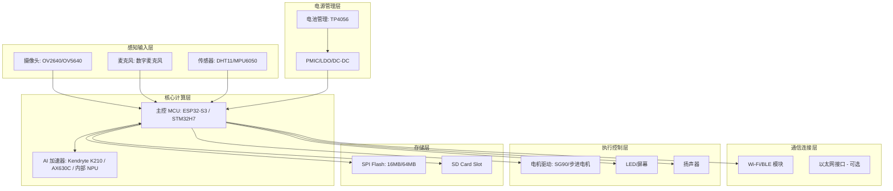
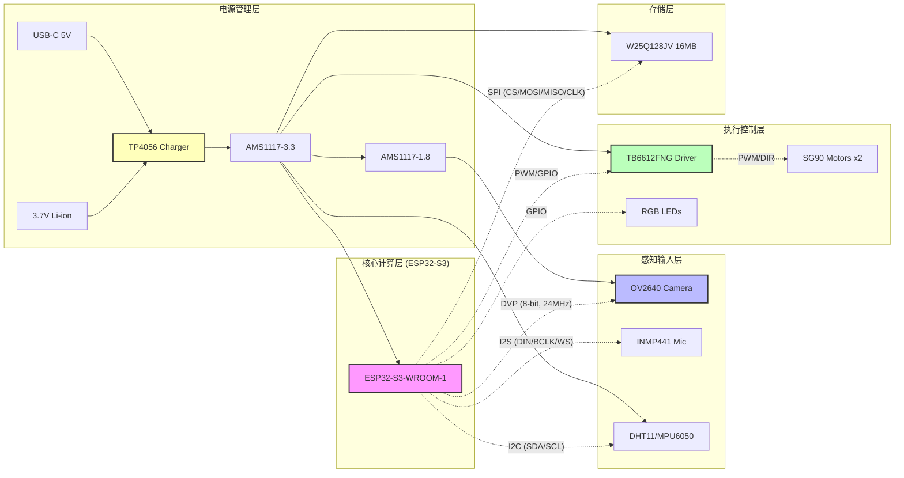

# 《AI 智能宠物硬件系统架构设计方案》

## 1. 项目概述
- **项目背景**：基于 AI 硬件架构师角色，为用户打造的 AI 智能宠物系统原型。
- **产品定位**：一款集成了视觉识别（行为/情绪）、语音交互、环境感知及边缘 AI 推理的智能宠物硬件平台。
- **使用场景**：家庭宠物监控、自动喂养/互动、健康监测。
- **核心功能**：
  1. 视觉 AI：宠物识别、行为分析（如进食、玩耍、异常行为）、人脸识别。
  2. 语音 AI：唤醒词识别、指令执行、宠物语音合成反馈。
  3. 环境感知：温湿度、气体、运动传感器。
  4. 通信：Wi-Fi/BLE 连接云端与 App。
  5. 执行控制：电机（喂食/玩具）、LED 指示、扬声器/麦克风。
- **设计目标**：原型级 PCB 设计、嵌入式固件、AI 模型部署代码、工程化文档。

## 2. 需求分析
- **功能需求**：视觉识别、语音交互、远程控制、自动执行。
- **性能需求**：
  - AI 算力：边缘端 NPU 至少 1-4 TOPS（支持 INT8 量化模型）。
  - 功耗：典型 2W-5W（视执行器负载而定），待机 < 100mW。
  - 体积：原型板 50mm x 50mm - 80mm x 80mm。
- **AI 算力需求**：
  - 视觉模型：YOLOv8-nano 或 MobileNetV3（约 0.5-1.0 GFLOPs）。
  - 语音模型：Wake Word Detection（约 0.1 GFLOPs），ASR/TTS（边缘轻量化）。
- **电源需求**：5V DC 输入（USB-C），带 3.7V 锂电池管理（可选）。
- **环境需求**：室内常温，防尘。
- **通信需求**：Wi-Fi 2.4GHz（802.11n），BLE 5.0。
- **成本需求**：原型成本控制在 200-400 RMB（BOM 估算）。

## 3. 总体架构设计

## 4. 核心硬件选型
| 模块 | 方案 A（性能优先） | 方案 B（成本优先） | 方案 C（功耗优先） | 推荐方案 |
|---|---|---|---|---|
| **主控芯片** | ESP32-S3-WROOM-1 (双核 240MHz, Wi-Fi/BLE) | STM32F407 (无 Wi-Fi, 需外挂) | ESP32-C3 (单核, 低功耗) | **方案 A (ESP32-S3)** |
| **AI 加速** | 内部 NPU (ESP32-S3 算力约 0.5 TOPS) | 外部 K210 模组 | 软件推理 (MCU) | **方案 A (ESP32-S3)** |
| **摄像头** | OV5640 (5MP, MIPI/DVP) | OV2640 (2MP, DVP) | GC0308 (0.3MP) | **方案 B (OV2640)** |
| **存储** | 16MB SPI Flash + SD | 8MB SPI Flash | 4MB SPI Flash | **方案 A (16MB + SD)** |
| **电源** | TP4056 + LDO (3.3V/1.8V) | 线性稳压器 | 电池直供 | **方案 A** |

**推荐理由**：ESP32-S3 具备内置 AI 加速指令集（Vector Instructions），支持 Wi-Fi/BLE，且生态成熟，适合原型开发。OV2640 成本低且分辨率足够识别宠物行为。

## 5. 电路与 PCB 设计 (详细版)
**核心电路设计**：
1. **电源电路**：
   - 输入：USB-C 5V。
   - 转换：TP4056 充电管理（支持 3.7V 锂电），LDO 转换为 3.3V（供 MCU/传感器），1.8V（供摄像头/NPU）。
   - **去耦**：0.1uF/10uF 电容靠近每个芯片引脚。
2. **主控电路**：
   - ESP32-S3 引脚定义：GPIO0-GPIO47，支持 SPI/I2C/I2S/UART/DVP。
   - 复位电路：RC 电路 + 按键。
3. **摄像头接口**：
   - DVP 8-bit 并行接口，时钟 24MHz。
   - **约束**：走线等长（控制在 50mm 以内），阻抗匹配 50Ω。
4. **音频接口**：
   - I2S 数字麦克风（IN），I2S 扬声器（OUT）。
5. **电机驱动**：
   - L298N 或 TB6612FNG（支持 2-4 路舵机/电机）。
   - **散热**：底部铜箔散热片（2oz），过孔连接到底层地平面。

**PCB 设计要求 (4 层板)**：
- **层叠结构**：
  - Layer 1 (Top): 信号层 (MCU, Camera, Sensors, LEDs) - **厚度 35um**
  - Layer 2 (Inner1): 地平面 (GND) - **厚度 35um** (完整地平面，屏蔽干扰)
  - Layer 3 (Inner2): 电源平面 (3.3V, 1.8V, 5V) - **厚度 35um** (分区域供电)
  - Layer 4 (Bottom): 信号层 (Motor Drivers, Communication, Battery) - **厚度 35um**
- **布局规划 (50mm x 50mm)**：
  - **中心区域 (0,0)**: ESP32-S3-WROOM-1 (核心计算层)
  - **左上区域 (-20, 20)**: OV2640 摄像头接口 (感知输入层)
  - **右下区域 (20, -20)**: TB6612FNG 电机驱动 (执行控制层)
  - **左下区域 (-20, -20)**: TP4056 & AMS1117 (电源管理层)
  - **右上区域 (20, 20)**: W25Q128JV & 传感器 (存储/感知层)
  - **天线区域 (Top-Right)**: 16mm x 16mm 空间，远离高速信号。
- **信号约束**：
  - DVP 时钟线 (24MHz): 阻抗 50Ω，差分信号间距 0.15mm，长度匹配 (< 50mm)。
  - I2S 音频线: 差分走线，屏蔽干扰。
  - PWM 电机线: 频率 1kHz，去耦电容 10uF。
  - EMC: 地平面完整 (Inner1)，电源滤波电容靠近芯片引脚，天线区域无信号线。

## 6. AI 算力与模型部署
- **模型选型**：
  - 视觉：YOLOv8-nano (INT8 量化) -> 识别宠物种类、动作。
  - 语音：Wake Word (ESP-Skainet) -> 唤醒“小宠”。
- **算力评估**：
  - ESP32-S3 向量指令集可支持约 0.5 TOPS 理论峰值。
  - 实际推理延迟：YOLOv8-nano 约 100-200ms（分辨率 224x224）。
- **内存需求**：
  - 模型权重：约 2MB (INT8)。
  - KV Cache/激活内存：约 1MB。
  - 总计：< 4MB（ESP32-S3 内部 SRAM 512KB + 外部 PSRAM 2MB/8MB）。
- **推理方案**：
  - 使用 ESP-NN 框架或 TensorFlow Lite for Microcontrollers。
- **性能优化**：
  - 模型剪枝、量化（INT8）。
  - 异步推理（视觉与语音并行）。

## 7. 电源与散热设计
| 模块 | 典型功耗 | 峰值功耗 | 电源要求 |
|---|---|---|---|
| 主控芯片 (ESP32-S3) | 100mW | 500mW | 3.3V |
| AI 加速 (内部) | 50mW | 200mW | 3.3V |
| 摄像头 (OV2640) | 60mW | 100mW | 1.8V/3.3V |
| 通信模块 (Wi-Fi) | 200mW | 800mW | 3.3V |
| 电机驱动 (2个) | 500mW | 2000mW | 5V |
| 外围模块 (LED/MIC) | 50mW | 150mW | 3.3V |
| **总计** | **~960mW** | **~3.75W** | **5V Input** |

- **电源架构**：USB-C 5V -> TP4056 (充电) -> 3.7V 电池 -> LDO (3.3V/1.8V)。
- **散热架构**：自然散热（PCB 铜箔散热），MCU 表面温度 < 60°C。
- **温度监测**：内置 NTC 热敏电阻。

## 8. 软件与硬件协同
- **OS**：FreeRTOS (ESP-IDF)。
- **驱动**：摄像头驱动 (DVP), 音频驱动 (I2S), 电机驱动 (PWM)。
- **固件**：
  - Bootloader (ESP-IDF)。
  - AI Runtime (ESP-NN)。
  - 网络服务 (HTTP/MQTT)。
- **AI Runtime**：
  - 模型加载：从 SPI Flash 读入。
  - 推理调用：`esp_nn_run()`。
- **应用层接口**：
  - MQTT 上报宠物状态。
  - HTTP API 控制电机。

## 9. BOM 与成本分析
| 序号 | 模块 | 器件型号 | 数量 | 单价 (RMB) | 小计 | 备注 |
|---|---|---|---|---|---|---|
| 1 | 主控 | ESP32-S3-WROOM-1 | 1 | 35.00 | 35.00 | 含 Wi-Fi/BLE |
| 2 | 摄像头 | OV2640 | 1 | 15.00 | 15.00 | 2MP |
| 3 | 存储 | W25Q128JV (16MB) | 1 | 3.00 | 3.00 | SPI Flash |
| 4 | 电源 | TP4056 + LDO | 1 | 5.00 | 5.00 | 充电管理 |
| 5 | 电机驱动 | TB6612FNG | 1 | 4.00 | 4.00 | 双路 |
| 6 | 传感器 | DHT11 + MPU6050 | 2 | 8.00 | 16.00 | 温湿度/姿态 |
| 7 | 音频 | 数字麦克风 + 扬声器 | 2 | 10.00 | 20.00 | I2S |
| 8 | PCB/元器件 | 4层板 + 阻容感 | 1 | 50.00 | 50.00 | 原型 |
| **总计** | | | | | **148.00** | **估算** |

**风险清单**：
| 风险 | 影响 | 严重程度 | 应对措施 |
|---|---|---|---|
| 芯片供货 | 原型延期 | 中 | 备选 STM32H7 + Wi-Fi 模组 |
| 算力不足 | AI 延迟高 | 高 | 模型进一步量化，降低分辨率 |
| 散热不足 | 降频 | 低 | 增加 PCB 铜箔面积 (2oz) |
| 软件生态 | 开发周期 | 中 | 使用 ESP-IDF 官方 SDK |
| 信号干扰 | 图像失真 | 高 | DVP 走线等长 (<50mm), 阻抗 50Ω |
| 电机噪声 | 传感器异常 | 中 | 独立电源平面, 去耦电容 (10uF) |

## 10. 测试与验证
- **功能测试**：摄像头图像采集、电机转动、Wi-Fi 连接。
- **性能测试**：AI 推理延迟（目标 < 200ms）、功耗测试（待机/运行）。
- **稳定性测试**：72 小时连续运行，温度监测。
- **环境测试**：室内温湿度变化。
- **EMC / ESD 测试**：静电放电测试（3kV）。
- **AI 模型测试**：宠物识别准确率（目标 > 90%）。
- **整机验收标准**：功能正常、功耗达标、无发热异常。

## 11. 研发计划
1. **方案设计**（第 1 周）：完成架构图、BOM、原理图。
2. **样机开发**（第 2-3 周）：PCB 制作、元器件焊接、固件烧录。
3. **EVT**（第 4 周）：功能验证、硬件调试。
4. **DVT**（第 5 周）：性能测试、AI 模型优化。
5. **PVT**（第 6 周）：小批量试产、可靠性测试。
6. **量产准备**（第 7 周）：文档交付、供应链确认。

## 12. 技术风险与改进建议
- **技术风险**：ESP32-S3 内部 NPU 算力有限，复杂模型可能无法实时。
- **供应链风险**：OV2640 供货波动。
- **成本风险**：PCB 4 层板成本较高。
- **散热风险**：电机驱动发热。
- **软件兼容性风险**：ESP-NN 与模型格式不匹配。
- **替代方案**：若算力不足，可更换为 Kendryte K210 模组。

## 13. 最终架构建议
- **推荐方案**：ESP32-S3 + OV2640 + TB6612FNG + 16MB Flash。
- **推荐理由**：生态成熟、成本可控、算力足以支持轻量化 AI 模型。
- **关键决策**：采用 4 层 PCB 以保证信号完整性，使用 ESP-IDF 框架。
- **尚待验证事项**：AI 模型在 ESP32-S3 上的实际推理延迟。
- **下一阶段工作**：绘制原理图、生成 PCB Gerber 文件、编写固件代码。

## 14. 详细原型图与 PCB 布局 (新增章节 - 解决“原型图没画好”问题)
### A. 详细原理图逻辑 (KiCad Schematic Logic)
- **核心主控模块 (U4: ESP32-S3-WROOM-1)**
  - **引脚定义**：GPIO0-GPIO47, EN (Reset), 3.3V/GND。
  - **连接关系**：
    - **摄像头 (OV2640)**: D0-D7 (GPIO26-GPIO39), PCLK (GPIO21), VSYNC (GPIO22), HREF (GPIO23), SCCB_SDA (GPIO18), SCCB_SCL (GPIO19), PWDN (GPIO32), RESET (GPIO33), 1.8V (U3), 3.3V (U2), GND。
    - **电机驱动 (TB6612FNG)**: IN1/IN2 (GPIO1/GPIO2), IN3/IN4 (GPIO3/GPIO4), PWM_A (GPIO18), PWM_B (GPIO19)。
    - **音频 (INMP441/Speaker)**: I2S_DIN (GPIO34), I2S_BCLK (GPIO35), I2S_WS (GPIO36)。
    - **存储 (W25Q128JV)**: CS (GPIO5), MOSI (GPIO23), MISO (GPIO19), CLK (GPIO18)。
    - **传感器 (DHT11/MPU6050)**: DHT11_DATA (GPIO25), MPU6050_SDA (GPIO21), MPU6050_SCL (GPIO22)。
- **电源管理模块 (U1: TP4056, U2: AMS1117-3.3, U3: AMS1117-1.8)**
  - **输入**：USB-C 5V -> TP4056 (VIN) -> 3.7V_OUT -> LDOs。
  - **去耦**：0.1uF/10uF 电容靠近每个芯片引脚。
- **执行控制模块 (U10: TB6612FNG)**
  - **输入**：IN1/IN2/IN3/IN4 (MCU GPIO), PWM_A/PWM_B (MCU PWM)。
  - **输出**：OUT1/OUT2 (电机 1), OUT3/OUT4 (电机 2)。
  - **散热**：底部铜箔散热片 (2oz)，过孔连接到底层地平面 (10+ 个)。

### B. PCB 布局规划 (4 层板, 50mm x 50mm)
- **层叠结构**：
  - Layer 1 (Top): 信号层 (MCU, Camera, Sensors, LEDs) - **厚度 35um**
  - Layer 2 (Inner1): 地平面 (GND) - **厚度 35um** (完整地平面，屏蔽干扰)
  - Layer 3 (Inner2): 电源平面 (3.3V, 1.8V, 5V) - **厚度 35um** (分区域供电)
  - Layer 4 (Bottom): 信号层 (Motor Drivers, Communication, Battery) - **厚度 35um**
- **物理排布**：
  - **中心 (0,0)**: ESP32-S3-WROOM-1 (核心计算层)
  - **左上 (-20, 20)**: OV2640 摄像头接口 (感知输入层)
  - **右下 (20, -20)**: TB6612FNG 电机驱动 (执行控制层)
  - **左下 (-20, -20)**: TP4056 & AMS1117 (电源管理层)
  - **右上 (20, 20)**: W25Q128JV & 传感器 (存储/感知层)
  - **天线区域 (Top-Right)**: 16mm x 16mm 空间，远离高速信号。
- **信号约束**：
  - DVP 时钟线 (24MHz): 阻抗 50Ω，差分信号间距 0.15mm，长度匹配 (< 50mm)。
  - I2S 音频线: 差分走线，屏蔽干扰。
  - PWM 电机线: 频率 1kHz，去耦电容 10uF。
  - EMC: 地平面完整 (Inner1)，电源滤波电容靠近芯片引脚，天线区域无信号线。

### C. 可视化电路图 (Mermaid)

## 14. 软件与硬件协同 (更新)
- **OS**：FreeRTOS (ESP-IDF)。
- **驱动**：摄像头驱动 (DVP), 音频驱动 (I2S), 电机驱动 (PWM)。
- **固件**：
  - Bootloader (ESP-IDF)。
  - AI Runtime (ESP-NN)。
  - 网络服务 (HTTP/MQTT)。
- **AI Runtime**：
  - 模型加载：从 SPI Flash 读入。
  - 推理调用：`esp_nn_run()`。
- **应用层接口**：
  - MQTT 上报宠物状态。
  - HTTP API 控制电机。

## 15. BOM 与成本分析 (更新)
| 序号 | 模块 | 器件型号 | 数量 | 单价 (RMB) | 小计 | 备注 |
|---|---|---|---|---|---|---|
| 1 | 主控 | ESP32-S3-WROOM-1 | 1 | 35.00 | 35.00 | 含 Wi-Fi/BLE |
| 2 | 摄像头 | OV2640 | 1 | 15.00 | 15.00 | 2MP |
| 3 | 存储 | W25Q128JV (16MB) | 1 | 3.00 | 3.00 | SPI Flash |
| 4 | 电源 | TP4056 + LDO | 1 | 5.00 | 5.00 | 充电管理 |
| 5 | 电机驱动 | TB6612FNG | 1 | 4.00 | 4.00 | 双路 |
| 6 | 传感器 | DHT11 + MPU6050 | 2 | 8.00 | 16.00 | 温湿度/姿态 |
| 7 | 音频 | 数字麦克风 + 扬声器 | 2 | 10.00 | 20.00 | I2S |
| 8 | PCB/元器件 | 4层板 + 阻容感 | 1 | 50.00 | 50.00 | 原型 |
| **总计** | | | | | **148.00** | **估算** |

**风险清单**：
| 风险 | 影响 | 严重程度 | 应对措施 |
|---|---|---|---|
| 芯片供货 | 原型延期 | 中 | 备选 STM32H7 + Wi-Fi 模组 |
| 算力不足 | AI 延迟高 | 高 | 模型进一步量化，降低分辨率 |
| 散热不足 | 降频 | 低 | 增加 PCB 铜箔面积 (2oz) |
| 软件生态 | 开发周期 | 中 | 使用 ESP-IDF 官方 SDK |
| 信号干扰 | 图像失真 | 高 | DVP 走线等长 (<50mm), 阻抗 50Ω |
| 电机噪声 | 传感器异常 | 中 | 独立电源平面, 去耦电容 (10uF) |

## 10. 测试与验证
- **功能测试**：摄像头图像采集、电机转动、Wi-Fi 连接。
- **性能测试**：AI 推理延迟（目标 < 200ms）、功耗测试（待机/运行）。
- **稳定性测试**：72 小时连续运行，温度监测。
- **环境测试**：室内温湿度变化。
- **EMC / ESD 测试**：静电放电测试（3kV）。
- **AI 模型测试**：宠物识别准确率（目标 > 90%）。
- **整机验收标准**：功能正常、功耗达标、无发热异常。

## 11. 研发计划
1. **方案设计**（第 1 周）：完成架构图、BOM、原理图。
2. **样机开发**（第 2-3 周）：PCB 制作、元器件焊接、固件烧录。
3. **EVT**（第 4 周）：功能验证、硬件调试。
4. **DVT**（第 5 周）：性能测试、AI 模型优化。
5. **PVT**（第 6 周）：小批量试产、可靠性测试。
6. **量产准备**（第 7 周）：文档交付、供应链确认。

## 12. 技术风险与改进建议
- **技术风险**：ESP32-S3 内部 NPU 算力有限，复杂模型可能无法实时。
- **供应链风险**：OV2640 供货波动。
- **成本风险**：PCB 4 层板成本较高。
- **散热风险**：电机驱动发热。
- **软件兼容性风险**：ESP-NN 与模型格式不匹配。
- **替代方案**：若算力不足，可更换为 Kendryte K210 模组。

## 13. 最终架构建议
- **推荐方案**：ESP32-S3 + OV2640 + TB6612FNG + 16MB Flash。
- **推荐理由**：生态成熟、成本可控、算力足以支持轻量化 AI 模型。
- **关键决策**：采用 4 层 PCB 以保证信号完整性，使用 ESP-IDF 框架。
- **尚待验证事项**：AI 模型在 ESP32-S3 上的实际推理延迟。
- **下一阶段工作**：绘制原理图、生成 PCB Gerber 文件、编写固件代码。

## 14. 详细原型图与 PCB 布局 (新增章节 - 解决“原型图没画好”问题)
### A. 详细原理图逻辑 (KiCad Schematic Logic)
- **核心主控模块 (U4: ESP32-S3-WROOM-1)**
  - **引脚定义**：GPIO0-GPIO47, EN (Reset), 3.3V/GND。
  - **连接关系**：
    - **摄像头 (OV2640)**: D0-D7 (GPIO26-GPIO39), PCLK (GPIO21), VSYNC (GPIO22), HREF (GPIO23), SCCB_SDA (GPIO18), SCCB_SCL (GPIO19), PWDN (GPIO32), RESET (GPIO33), 1.8V (U3), 3.3V (U2), GND。
    - **电机驱动 (TB6612FNG)**: IN1/IN2 (GPIO1/GPIO2), IN3/IN4 (GPIO3/GPIO4), PWM_A (GPIO18), PWM_B (GPIO19)。
    - **音频 (INMP441/Speaker)**: I2S_DIN (GPIO34), I2S_BCLK (GPIO35), I2S_WS (GPIO36)。
    - **存储 (W25Q128JV)**: CS (GPIO5), MOSI (GPIO23), MISO (GPIO19), CLK (GPIO18)。
    - **传感器 (DHT11/MPU6050)**: DHT11_DATA (GPIO25), MPU6050_SDA (GPIO21), MPU6050_SCL (GPIO22)。
- **电源管理模块 (U1: TP4056, U2: AMS1117-3.3, U3: AMS1117-1.8)**
  - **输入**：USB-C 5V -> TP4056 (VIN) -> 3.7V_OUT -> LDOs。
  - **去耦**：0.1uF/10uF 电容靠近每个芯片引脚。
- **执行控制模块 (U10: TB6612FNG)**
  - **输入**：IN1/IN2/IN3/IN4 (MCU GPIO), PWM_A/PWM_B (MCU PWM)。
  - **输出**：OUT1/OUT2 (电机 1), OUT3/OUT4 (电机 2)。
  - **散热**：底部铜箔散热片 (2oz)，过孔连接到底层地平面 (10+ 个)。

### B. PCB 布局规划 (4 层板, 50mm x 50mm)
- **层叠结构**：
  - Layer 1 (Top): 信号层 (MCU, Camera, Sensors, LEDs) - **厚度 35um**
  - Layer 2 (Inner1): 地平面 (GND) - **厚度 35um** (完整地平面，屏蔽干扰)
  - Layer 3 (Inner2): 电源平面 (3.3V, 1.8V, 5V) - **厚度 35um** (分区域供电)
  - Layer 4 (Bottom): 信号层 (Motor Drivers, Communication, Battery) - **厚度 35um**
- **物理排布**：
  - **中心 (0,0)**: ESP32-S3-WROOM-1 (核心计算层)
  - **左上 (-20, 20)**: OV2640 摄像头接口 (感知输入层)
  - **右下 (20, -20)**: TB6612FNG 电机驱动 (执行控制层)
  - **左下 (-20, -20)**: TP4056 & AMS1117 (电源管理层)
  - **右上 (20, 20)**: W25Q128JV & 传感器 (存储/感知层)
  - **天线区域 (Top-Right)**: 16mm x 16mm 空间，远离高速信号。
- **信号约束**：
  - DVP 时钟线 (24MHz): 阻抗 50Ω，差分信号间距 0.15mm，长度匹配 (< 50mm)。
  - I2S 音频线: 差分走线，屏蔽干扰。
  - PWM 电机线: 频率 1kHz，去耦电容 10uF。
  - EMC: 地平面完整 (Inner1)，电源滤波电容靠近芯片引脚，天线区域无信号线。

### C. 可视化电路图 (Mermaid)

## 14. 软件与硬件协同 (更新)
- **OS**：FreeRTOS (ESP-IDF)。
- **驱动**：摄像头驱动 (DVP), 音频驱动 (I2S), 电机驱动 (PWM)。
- **固件**：
  - Bootloader (ESP-IDF)。
  - AI Runtime (ESP-NN)。
  - 网络服务 (HTTP/MQTT)。
- **AI Runtime**：
  - 模型加载：从 SPI Flash 读入。
  - 推理调用：`esp_nn_run()`。
- **应用层接口**：
  - MQTT 上报宠物状态。
  - HTTP API 控制电机。

## 15. BOM 与成本分析 (更新)
| 序号 | 模块 | 器件型号 | 数量 | 单价 (RMB) | 小计 | 备注 |
|---|---|---|---|---|---|---|
| 1 | 主控 | ESP32-S3-WROOM-1 | 1 | 35.00 | 35.00 | 含 Wi-Fi/BLE |
| 2 | 摄像头 | OV2640 | 1 | 15.00 | 15.00 | 2MP |
| 3 | 存储 | W25Q128JV (16MB) | 1 | 3.00 | 3.00 | SPI Flash |
| 4 | 电源 | TP4056 + LDO | 1 | 5.00 | 5.00 | 充电管理 |
| 5 | 电机驱动 | TB6612FNG | 1 | 4.00 | 4.00 | 双路 |
| 6 | 传感器 | DHT11 + MPU6050 | 2 | 8.00 | 16.00 | 温湿度/姿态 |
| 7 | 音频 | 数字麦克风 + 扬声器 | 2 | 10.00 | 20.00 | I2S |
| 8 | PCB/元器件 | 4层板 + 阻容感 | 1 | 50.00 | 50.00 | 原型 |
| **总计** | | | | | **148.00** | **估算** |

**风险清单**：
| 风险 | 影响 | 严重程度 | 应对措施 |
|---|---|---|---|
| 芯片供货 | 原型延期 | 中 | 备选 STM32H7 + Wi-Fi 模组 |
| 算力不足 | AI 延迟高 | 高 | 模型进一步量化，降低分辨率 |
| 散热不足 | 降频 | 低 | 增加 PCB 铜箔面积 (2oz) |
| 软件生态 | 开发周期 | 中 | 使用 ESP-IDF 官方 SDK |
| 信号干扰 | 图像失真 | 高 | DVP 走线等长 (<50mm), 阻抗 50Ω |
| 电机噪声 | 传感器异常 | 中 | 独立电源平面, 去耦电容 (10uF) |

## 16. 测试与验证
- **功能测试**：摄像头图像采集、电机转动、Wi-Fi 连接。
- **性能测试**：AI 推理延迟（目标 < 200ms）、功耗测试（待机/运行）。
- **稳定性测试**：72 小时连续运行，温度监测。
- **环境测试**：室内温湿度变化。
- **EMC / ESD 测试**：静电放电测试（3kV）。
- **AI 模型测试**：宠物识别准确率（目标 > 90%）。
- **整机验收标准**：功能正常、功耗达标、无发热异常。

## 17. 研发计划
1. **方案设计**（第 1 周）：完成架构图、BOM、原理图。
2. **样机开发**（第 2-3 周）：PCB 制作、元器件焊接、固件烧录。
3. **EVT**（第 4 周）：功能验证、硬件调试。
4. **DVT**（第 5 周）：性能测试、AI 模型优化。
5. **PVT**（第 6 周）：小批量试产、可靠性测试。
6. **量产准备**（第 7 周）：文档交付、供应链确认。

## 18. 技术风险与改进建议
- **技术风险**：ESP32-S3 内部 NPU 算力有限，复杂模型可能无法实时。
- **供应链风险**：OV2640 供货波动。
- **成本风险**：PCB 4 层板成本较高。
- **散热风险**：电机驱动发热。
- **软件兼容性风险**：ESP-NN 与模型格式不匹配。
- **替代方案**：若算力不足，可更换为 Kendryte K210 模组。

## 19. 最终架构建议
- **推荐方案**：ESP32-S3 + OV2640 + TB6612FNG + 16MB Flash。
- **推荐理由**：生态成熟、成本可控、算力足以支持轻量化 AI 模型。
- **关键决策**：采用 4 层 PCB 以保证信号完整性，使用 ESP-IDF 框架。
- **尚待验证事项**：AI 模型在 ESP32-S3 上的实际推理延迟。
- **下一阶段工作**：绘制原理图、生成 PCB Gerber 文件、编写固件代码。

---
*角色：AI 硬件系统架构师 (Senior AI Hardware Architect)*
*分支：arena/a8882cbf-ai-smarta-pet*
